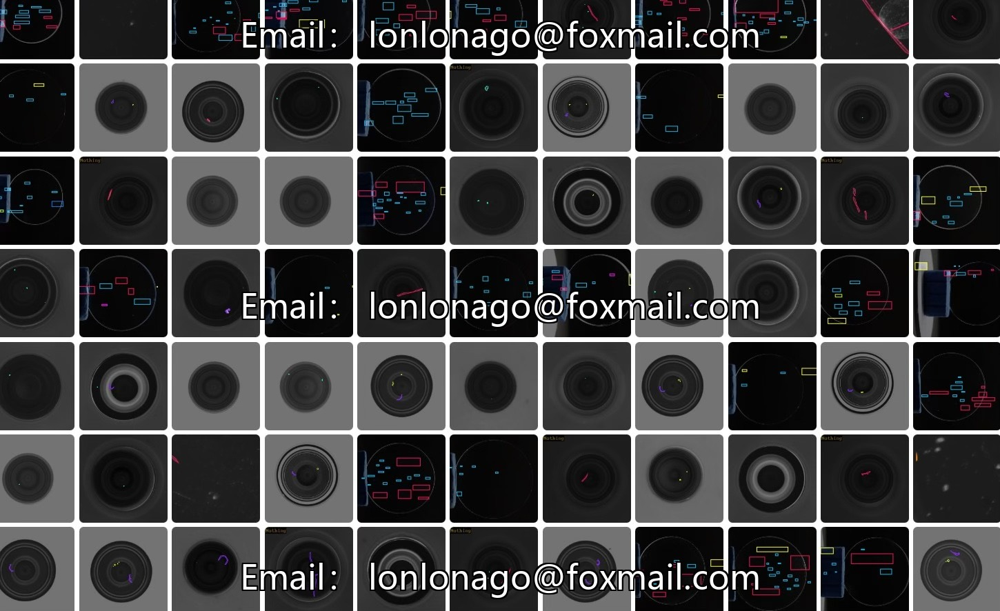
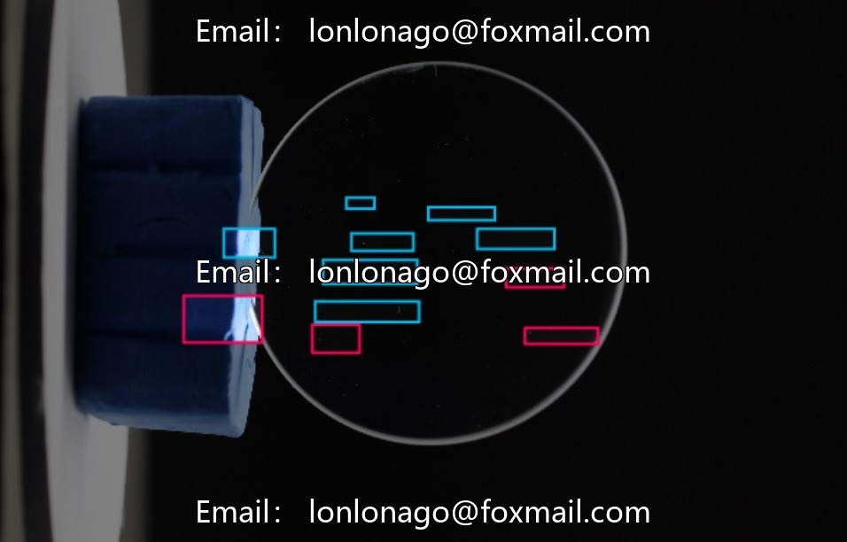
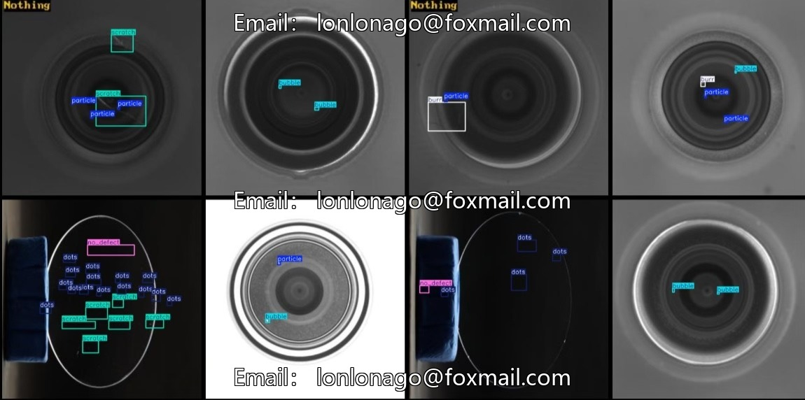

# Optical Lens Defect Detection Dataset

## Body

Optical Lens Defect Detection Dataset for Intelligent Industrial Applications - Optical Lens Defect Detection Dataset, Industrial Lens Defect Detection Dataset. Supports automatic classification and localization of industrial defect quality, including scratch detection, burr recognition, etc. Issue #10533

The dataset consists of 9 categories of lens defects and status annotations: cracks, scratches, bubbles, particles, burrs, deep scratches, spots, no defect, other defects. It contains 1100 high-quality images in YOLO format annotation, covering common lens flaws in industrial production, fine-grained category division, and enhances the model's detection accuracy and robustness.

The dataset is moderate in size, suitable for model training and rapid iterations. The images are from real industrial scenes, reflecting the diversity of lens defects, providing a realistic training foundation for the model.

Suitable for industrial quality inspection automation, defect classification and positioning, quality traceability and optimization, algorithm research and verification, etc.

Virtual materials, once sold, are non-refundable.
Interested friends, click "I want" to proceed.

## Images

## Payment

Here is a pay link on Stripe ( https://buy.stripe.com/3cs8yP7sY87d0vu9AB ). Please contact me lonlonago@foxmail.com after funding $89, and I will send you a complete data files , thank you!

